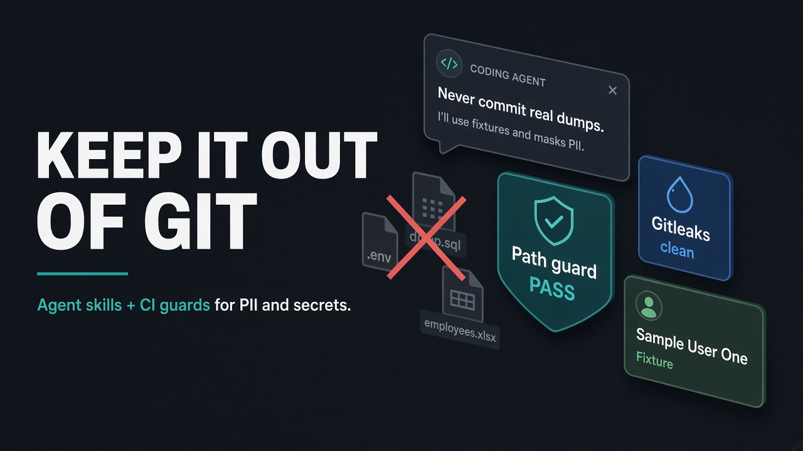
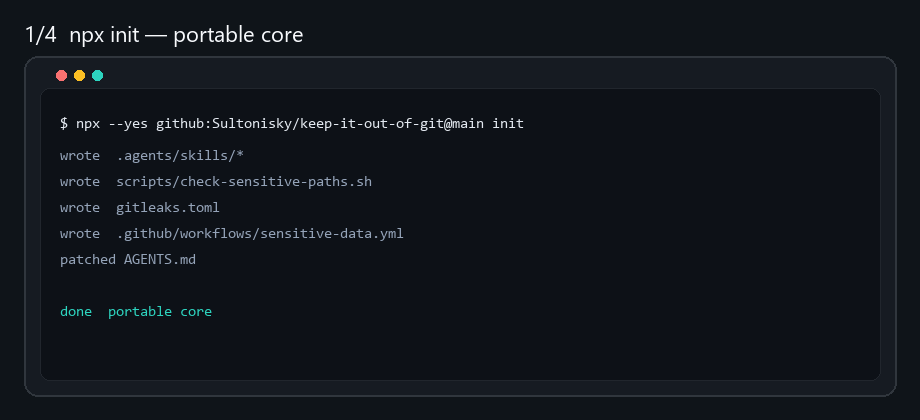
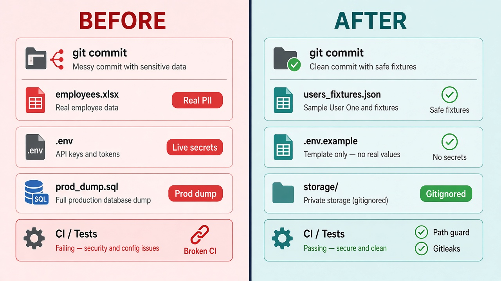
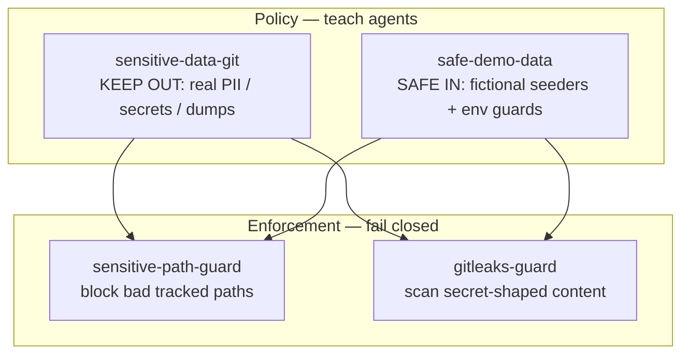

# Keep It Out of Git

<p align="center">
  
</p>

**People data and secrets do not belong in git.**  
Safe fictional demos do.

This pack gives your coding agent (Cursor, Copilot, or any agent that reads
skills / `AGENTS.md`) the rules — then installs **path + secret guards** so the
repo enforces them even when someone forgets.

| | |
|---|---|
| **Author** | [Sultonisky](https://github.com/Sultonisky) |
| **License** | MIT |
| **Stage** | early — portable core first; tool-native packs deepen over time |

---

## 60-second demo

`npx init` → files land → dump gets blocked → path check passes.

<p align="center">
  
</p>

<details>
<summary>Static storyboard (if the GIF does not animate)</summary>

<p align="center">
  
</p>

</details>

```bash
# 1) install portable core into your project
npx --yes github:Sultonisky/keep-it-out-of-git@main init

# 2) catch a tracked dump / .env / private path
bash scripts/check-sensitive-paths.sh
# → BLOCKED tracked path: data/employees-export.xlsx  (exit 1)

# 3) move to gitignored private storage, unstage, re-run
bash scripts/check-sensitive-paths.sh
# → Sensitive-path check passed.
```

---

## What you get (the point)

Install once. Your project gains **policy for agents** + **CI that fails closed**
on bad paths and secret-shaped content — without teaching every teammate from
scratch.

<p align="center">
  
</p>

| Before (risky) | After (this pack) |
|---|---|
| Real employee / customer rows in fixtures | `Sample User One` / `user.test@example.com` |
| `.env` or API keys in the tree | `.env.example` only; secrets from env |
| `prod_dump.sql` / CRM exports tracked | Private gitignored storage + scrubbed stubs |
| Agent happily stages a dump “for the bug” | Skills + `AGENTS.md` steer agents away |
| Hope nobody notices | Path blocklist + gitleaks CI fail the PR |

---

## After `init` — what lands in the repo

<p align="center">
  
</p>

**Default `npx … init` writes the portable core:**

| Written | You get |
|---|---|
| `.agents/skills/*` | Four skills agents can load |
| `scripts/check-sensitive-paths.sh` | Tracked-path blocklist (`.env`, dumps, private dirs, …) |
| `AGENTS.md` block | Documented private path + guard checklist |
| `.github/copilot-instructions.md` block | Copilot discovery (Copilot often ignores `.agents/`) |
| `gitleaks.toml` | Secret **content** scan config |
| `.github/workflows/sensitive-data.yml` | Additive CI job (does **not** rewrite existing `ci-cd.yml`) |
| `.agents/keep-it-out-of-git.POST_INSTALL.md` | Checklist for your coding agent to finish wiring |
| `.agents/keep-it-out-of-git.INSTALL.json` | Machine-readable written/skipped + pack version |

Optional flags also copy skills into `.cursor/skills/` and/or a PR template.

> **Bootstrap, not finished.** `init` drops files; your agent should complete
> project-specific wiring from `POST_INSTALL.md` (private path, CI merge,
> allowlists, safe seeders).

---

## How the four skills fit

<p align="center">
  
</p>



| Skill | Role |
|---|---|
| [`sensitive-data-git`](./sensitive-data-git/) | What stays **out**; private storage; catalog; log redaction |
| [`safe-demo-data`](./safe-demo-data/) | What may stay **in**: seeders/factories/fixtures with guards |
| [`sensitive-path-guard`](./sensitive-path-guard/) | `check-sensitive-paths.sh` tracked-path blocklist |
| [`gitleaks-guard`](./gitleaks-guard/) | gitleaks config, CI, allowlist hygiene, triage |

Predictive across domains (identity, auth, finance, health, CRM, education,
infra) — not one product shape.

---

## Result in practice

```text
# Local path check
$ bash scripts/check-sensitive-paths.sh
BLOCKED tracked path: data/employees-export.xlsx
# exit 1  →  move to gitignored private storage, unstage, re-run

# Clean tree
$ bash scripts/check-sensitive-paths.sh
Sensitive-path check passed.
```

```text
# Bad seeder mental model          # Good (safe-demo-data)
name: "Alex from staging"          name: "Sample User One"
api_key: "sk_live_...."            api_key: from env / placeholder
no production guard                refuse when env === production
```

---

## Install

Preferred path first. Any method works.

### Preferred — `npx` (Windows / macOS / Linux, Node 18+)

```bash
# from your project root — portable core (recommended)
npx --yes github:Sultonisky/keep-it-out-of-git@main init
```

Use `@main` + `--yes` when re-testing so npx does not reuse a stale cache.

```bash
npx github:Sultonisky/keep-it-out-of-git init --cursor
npx github:Sultonisky/keep-it-out-of-git init --pr
npx github:Sultonisky/keep-it-out-of-git init --all
npx github:Sultonisky/keep-it-out-of-git init --minimal
npx github:Sultonisky/keep-it-out-of-git init --dry-run
npx github:Sultonisky/keep-it-out-of-git --help
```

| Flag | Effect |
|---|---|
| *(default)* | Portable core (table above) |
| `--minimal` | Skills + path script only |
| `--cursor` | Also copy skills → `.cursor/skills/` |
| `--pr` | Also copy `.github/pull_request_template.md` |
| `--all` | Portable core + `--cursor` + `--pr` |
| `--force` | Overwrite existing managed files |
| `--dry-run` | Print actions only |

Files from `init` start **untracked** — `git add` + commit/PR them so CI can run.

On Windows, run the path script via **Git Bash or WSL** (`bash` is not always on
PATH in PowerShell).

After npm publish you can also use `npx keep-it-out-of-git init`.

### Alternate — `install.sh` (Unix / Git Bash)

```bash
git clone https://github.com/Sultonisky/keep-it-out-of-git.git
cd your-project
bash /path/to/keep-it-out-of-git/install.sh init --cursor
```

If Node is available, the script delegates to the same CLI as npx. Without Node,
bash falls back to a **default init only** (skills + path script).

### Manual — clone + guided copy

1. Clone this repository (or browse the skill folders online)
2. Copy skill folders:
   - Portable: `.agents/skills/<skill-name>/`
   - Cursor (optional): `.cursor/skills/<skill-name>/`
3. Copy
   [`sensitive-path-guard/scripts/check-sensitive-paths.sh`](./sensitive-path-guard/scripts/check-sensitive-paths.sh)
   → `scripts/check-sensitive-paths.sh` and adapt allow/block regexes
4. Paste policy blocks from each skill’s `templates.md` into `AGENTS.md`
5. Optional: `gitleaks.toml`, CI job, and
   [`templates/pull_request_template.md`](./templates/pull_request_template.md)

### After install (all methods)

1. Document **this repo’s** private storage path in `AGENTS.md`
2. Run `bash scripts/check-sensitive-paths.sh`
3. Point your agent at `AGENTS.md` and/or skill folders

---

## When to use which skill

| Situation | Skill |
|---|---|
| Commit review, dumps, private storage, “is this sensitive?” | `sensitive-data-git` |
| Writing/reviewing seeders, factories, fixtures | `safe-demo-data` |
| Path blocklist CI failures | `sensitive-path-guard` |
| Gitleaks failures / allowlists | `gitleaks-guard` |

---

## Design notes

- Portable **rules** first; stack paths and IDE wiring are additive presets
- Document *this repo’s* private storage path in `AGENTS.md` (required)
- Instructions stay concise; details live in `templates.md` / `examples.md`
- Examples use fictional identities only (`Sample…` / `Test…`)
- No real operational people data in this repo
- Path checks and gitleaks complement each other — neither replaces the other
- Installer preference: **npx first**, `install.sh` alternate, manual always available

```text
                         ┌─ Cursor / Copilot     ← nicer agent DX
  portable core ─────────┼─ Laravel path preset  ← clearer default paths
  (policy + CI + script) └─ Nest/Express/other   ← same rules, mapped paths
```

---

## Community

| Doc | Purpose |
|---|---|
| [CONTRIBUTING.md](./CONTRIBUTING.md) | How to propose changes, PR process |
| [CODE_OF_CONDUCT.md](./CODE_OF_CONDUCT.md) | Community standards |
| [SECURITY.md](./SECURITY.md) | Private vulnerability / leak reporting |
| [ROADMAP.md](./ROADMAP.md) | What’s next |

Issues and PRs welcome — catalog gaps, path false positives/negatives, stack
presets, and agent/tool feedback. Keep contributions generic; never add real
people data or live credentials.

## License

MIT — Copyright (c) 2026 Sultonisky. See [LICENSE](./LICENSE).
